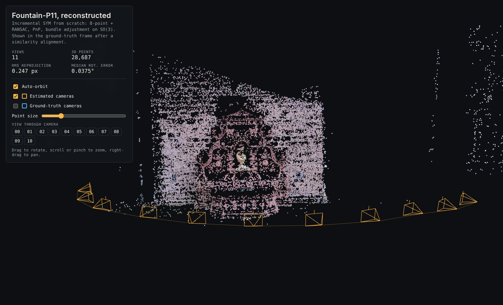
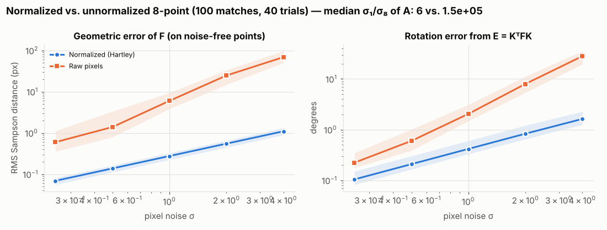
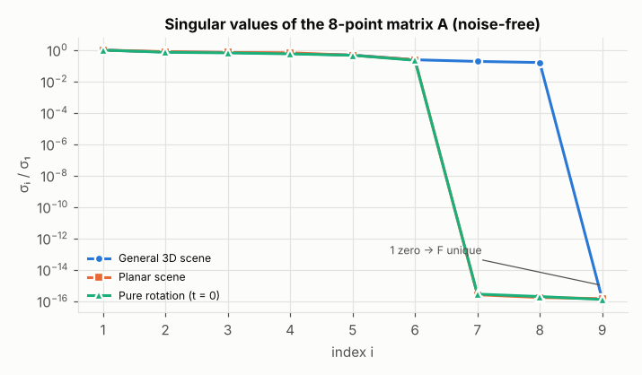
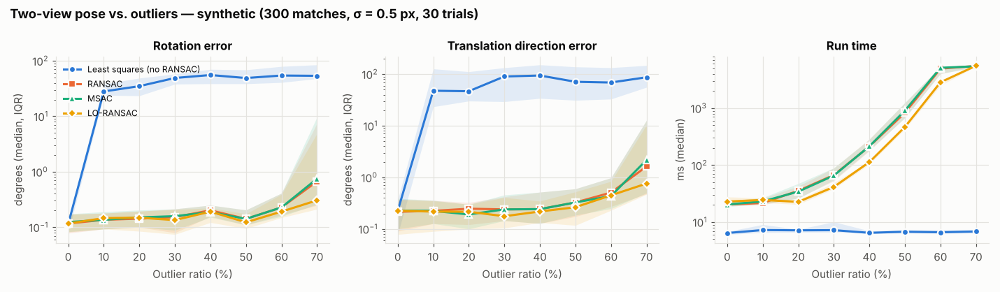
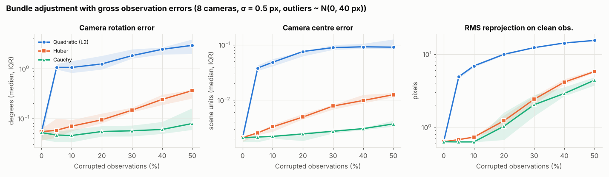
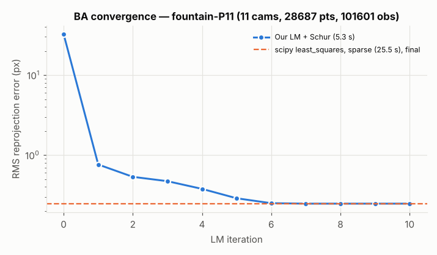
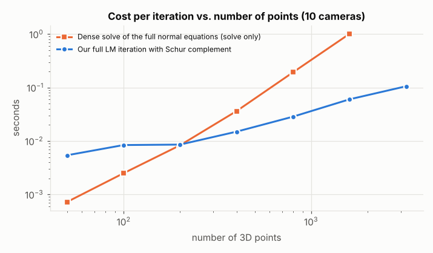

# Mini-SfM from scratch

A small Structure-from-Motion pipeline written from scratch in NumPy/SciPy (HUJI 3D computer vision project).

OpenCV is used only for image I/O, SIFT features, and as a **baseline** for comparison. The geometry core never calls it: 8-point, essential matrix, RANSAC, triangulation, PnP and bundle adjustment are all written here.

**Input:** images of a scene with known intrinsics K.

**Output:**
- a coloured 3D point cloud;
- camera poses (R_i, t_i);
- a Three.js viewer;
- an experimental study of robustness to outliers.

**[▶ Live 3D viewer](https://noamk15.github.io/3D/viewer/)** (GitHub Pages, see "Publish the viewer" below).



## Results on fountain-P11 (11 images, Strecha et al. ground truth)

| | Value |
|---|---|
| Registered views | **11 / 11** |
| 3D points / observations | 28,687 / 101,601 |
| RMS reprojection error after BA | **0.247 px** |
| Camera rotation error vs. ground truth (median / max) | **0.037° / 0.052°** |
| Camera centre error vs. ground truth (median / max) | 0.03% / 0.05% of scene size |
| Relative pose, 51 pairs, median rotation / translation-direction error | ours **0.051° / 0.13°**, OpenCV 5-point 0.23° / 0.26° |
| BA from a perturbed start (RMS 32.5 px), 86k unknowns | our LM + Schur: 10 iterations, 5.3 s; scipy sparse TRF: 25.5 s, same minimum |
| Run time | SIFT + all-pairs matching 174 s, SfM 52 s (images at 1536×1024) |

Robustness:
- Least squares fails at 10% wrong matches (rotation error 28°).
- RANSAC / MSAC / LO-RANSAC stay at ~0.1–0.2° up to 60% outliers.
- At 70%, the 20,000-iteration budget is too small (≈105,000 needed for s = 8), which is the practical breakdown point.
- In BA, 5% gross errors raise the camera rotation error from 0.05° to 1.06° with L2; with a Cauchy loss it stays at 0.05–0.08° up to 50%.

## Pipeline

| # | Block | Module | Key idea |
|---|---|---|---|
| 1 | Normalized 8-point for F | `two_view.py` | Hartley normalization, SVD, rank-2 projection (Eckart–Young) |
| 2 | Essential matrix and pose | `two_view.py` | E = KᵀFK, projected to singular values (1,1,0); 4 candidates; cheirality |
| 3 | Triangulation | `triangulation.py` | DLT, then Gauss–Newton on the reprojection error |
| 4 | Robust estimation | `robust.py` | RANSAC / MSAC / LO-RANSAC, adaptive iteration count, Sampson error |
| 5 | PnP and incremental SfM | `pnp.py`, `incremental.py` | DLT-PnP + RANSAC + SE(3) refinement; union-find tracks |
| 6 | Real data | `features.py` | SIFT + Lowe ratio test + mutual check, verified by our F-RANSAC |
| 7 | Bundle adjustment | `ba.py` | Hand-written LM, so(3) left updates, Schur complement, Huber/Cauchy via IRLS; scipy sparse version for comparison |
| 8 | Viewer | `viewer/` | Three.js: coloured cloud, estimated and ground-truth frustums, "look through camera" |
| 9 | Robustness study | `experiments/robustness.py` | Error vs. outlier ratio; breakdown point |
| 10 | Oral preparation | `docs/oral_prep.md` | Intuition (FR), formal statements (EN), likely questions |

## Layout

```
sfm/          core library (geometry, synthetic, two_view, triangulation, robust, pnp, ba, incremental, features, io)
tests/        unit tests on synthetic ground truth (pytest)
experiments/  reproducible scripts that generate every number and figure
viewer/       Three.js viewer (app.html + scene.js; build.py makes index.html)
docs/         oral preparation + figures
data/         datasets (not committed)
```

## Install and run

```bash
pip install -r requirements.txt
pytest -q                                   # unit tests (F, E, R in SO(3), triangulation, RANSAC, PnP, BA, Schur = full step)

# fountain-P11 (images + ground-truth cameras), e.g. from openMVG's benchmark repo:
git clone --depth 1 https://github.com/openMVG/SfM_quality_evaluation
cp -r SfM_quality_evaluation/Benchmarking_Camera_Calibration_2008/fountain-P11 data/

python -m experiments.run_fountain          # full pipeline + ground-truth evaluation + OpenCV baseline
python -m experiments.conditioning          # normalization, degeneracies, baseline figures
python -m experiments.robustness            # outlier study (two-view + BA losses), takes a while
python -m experiments.ba_convergence        # BA convergence + Schur scaling
python viewer/build.py experiments/out/fountain_scene.json   # rebuild viewer data
```

## Publish the viewer

Go to Settings → Pages, then Source: *Deploy from a branch*, Branch: `main`, folder `/ (root)`. The viewer is then served at `https://noamk15.github.io/3D/viewer/`.

## Figures

| | |
|---|---|
|  |  |
|  |  |
|  |  |
